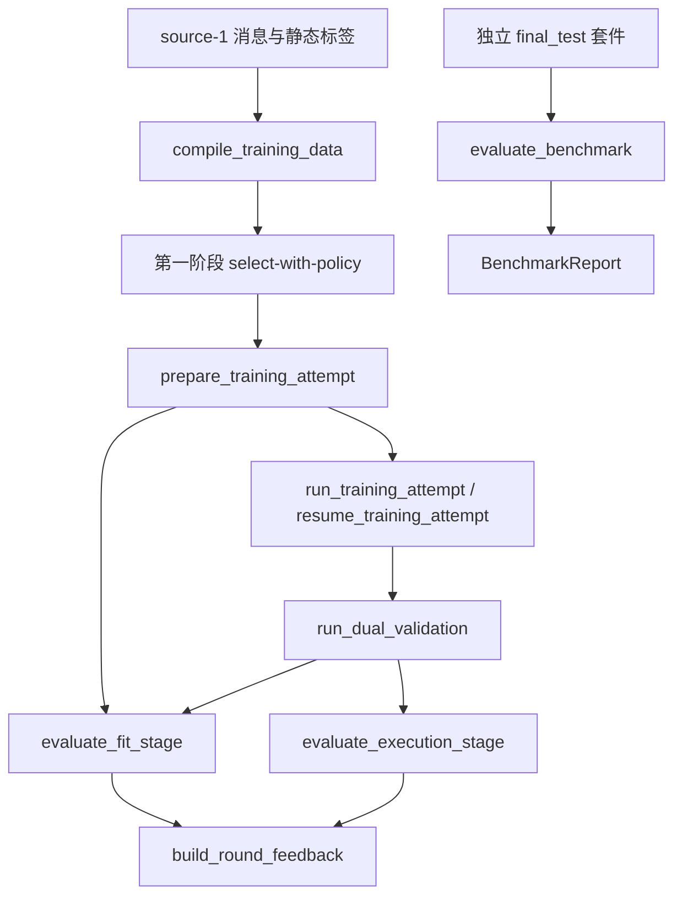

# 单次训练与双路验证接口

本接口消费第一阶段的冻结选择。它执行一次训练，并比较父模型和候选模型。控制 Agent、多轮 RSI 和模型自动晋级仍未实现。

实现已适配 0.7.0 功能子包。目录归属见 [代码结构与维护](代码结构与维护.md)。新调用使用 `rsi.workflows.attempt_run`、`rsi.evaluation.fit_evaluation` 等实现路径。旧根目录路径继续兼容。训练恢复和阶段缓存统一使用递归源码身份，覆盖第二阶段所在子包。

## 调用关系

`training_cli` 只处理参数和输出。`training_inputs` 复用原消息编译器。`execution_plan` 核验选择输入、策略、评分、批次和顺序。它不调用排名器或组批器。`attempt_run` 负责单批计划、账本、执行和恢复。`hf_backend` 负责实际模型计算。`training_mock` 只提供显式测试值。

`validation_run` 串行加载模型。它组织两次拟合和两次自由执行。`fit_evaluation`、`execution_evaluation` 和 `round_feedback` 提供独立业务接口。`benchmark_run` 复用同一执行评估器，但不调用验收或反馈构建器。

## 数据编译和标签

`source-1` 保留原字段约束。每条来源必须声明 data_id、角色、split_group、duplicate_group、技能、质量和消息。每条消息必须声明 role、content、correctness、supervise、evidence_id 和 diagnostics。未知格式需要显式 SourceAdapter；程序不猜测工具结构。

真实模式使用本地 fast tokenizer 和实际聊天模板。编译不截断数据。编译检查文本往返，并记录模板边界。只有请求监督的有效 assistant 内容进入损失。模板、用户、工具、错误动作和跨内容边界 token 不进入损失。

输出包含 `sources.jsonl`、`trajectories.jsonl` 和 `message_mappings.json`。消息映射记录零起点消息索引、角色、字符范围和完整 token 位置。`metadata.jsonl` 提供已有静态标签。编译器显式重绑轨迹版本、分区、token 成本、评分和使用快照。它不生成真实技能标签，不改变标签来源。

mock 模式重新编译 source-1。它不会把第一阶段的 demo 状态直接改为 verified。其测试分词器确实执行编码、位置映射和往返检查；`provenance.json` 同时声明 `execution_mode=mock` 和 `source=synthetic_fixture`。这些 token 不对应真实模型。

训练准备和加载还会核对编译 provenance 的模式、分词方式与来源。mock 编译产物不能用于 hf_local 训练。修改训练配置不能把测试 token 变成真实模型 token。此类错误在加载模型前被拒绝。

## 模型和配置

`ModelLocation` 使用 `model-location-v1`。字段为 model_ref、base_model_path、adapter_manifest 和 load。相对路径以定位文件所在目录为基准。模型内容身份不使用定位路径替代文件哈希。

无 adapter 的模型必须声明 `adapter_revision=none`。已有 adapter 的模型必须提供清单路径和 SHA-256。加载前重验基座、tokenizer、模板和 adapter。GPU 还必须核验完整 UUID 与型号。当前只支持单设备。

加载配置明确 precision、attention_implementation、local_files_only 和 trust_remote_code。只允许本地加载并禁用 remote code。LoRA 配置明确 targets、alpha 和 dropout。每个 target 必须匹配实际模型模块。继续训练时，rank、targets、alpha 和 dropout 必须与父 adapter 相同。

`training-attempt-v1` 复用 TrainingConfig，追加 mode、lora 和 load。第一版要求单设备、每次一个完整轨迹、不使用梯度累积。每条轨迹按有效监督 token 的平均损失更新一次。它不是跨轨迹 token 加权训练。诊断聚合则按 token 加权。

## 冻结计划和训练状态

`training-plan-v1` 保存选择清单身份、输入哈希、成员、原顺序、训练参数、模型起点和来源。成员指纹与顺序哈希分开保存。相同成员的不同顺序产生不同训练请求身份。

单批计划使用现有 StateStore 的事务、events、reservations 和 costs。新事件为 `single-training-plan-v1`。数据库结构仍为版本 1，不迁移旧数据库，不伪造 comparison。旧对照与单批执行共用合法批次读取和成本校验。

准备训练时，将编译快照中已发生的普通评分成本导入本轮账本。拟合评估继续使用剩余评分预算，不能因准备新目录而重置同一轮已发生的评分消耗。独立 benchmark 使用单独账本与显式调用预算，成本不进入验收。

训练执行器按冻结顺序运行。账本拒绝非批次样本、跳步和重复步骤。完成时必须核对实际逐条使用量，不能只比较 token 总数。重复完成请求核验产物后返回，不重复训练或计费。

从父 adapter 开始的新尝试加载其参数，并创建新优化器和调度器。它不加载父优化器状态。完整步骤恢复则加载原尝试的 adapter、优化器、调度器和随机状态。恢复必须提供清单与哈希。程序拒绝旧检查点、未知步骤意图、缺失步骤、不同源码或依赖，以及已经失败或完成的尝试。

已完成反向传播的 token 即产生训练成本。保存失败不能删除成本。失败现场保留在原目录。程序不自动重跑未知消耗。独立训练的候选模型清单绑定 adapter 文件和父模型；耗时、账本和优化器作为运行证据保存。

登记完成前，程序还会核验后端返回的候选基座、tokenizer、模板、adapter 清单和实际监督量。诊断文件存在时，程序核验其文件哈希。后端返回了数据类对象，不代表该结果已经通过核验。

Windows 检查点目录发布遇到错误码 5 或 32 时，最多进行四次重命名尝试。重试只涉及已经保存好的目录，不重复训练、反向传播或保存状态。永久失败保留 pending 目录并继续抛出异常。

## 整条轨迹与技能片段拟合

两种统计使用同一固定参考输入和原训练掩码。模型按参考前缀预测下一个 token。监督目标只向左移一次。NLL 使用自然对数。熵使用完整词表分布。

例如，整条轨迹有 10 个有效监督 token。技能证据覆盖 3 个 assistant token 和 2 个 tool token。整条统计使用 10 个 token。技能统计只使用那 3 个 assistant token。训练仍使用原来的 10 个 token。

`evaluate_fit` 同时返回逐 token 事实、逐条 whole_record、逐条 by_skill、总体和技能汇总。`compare_fit` 返回 after − before 的 NLL 与熵差值。负 NLL 差值表示该固定参考上的拟合损失下降，不能据此推断自由任务能力提升。

技能证据类型为 `SkillEvidence`。它明确绑定 data_id、trajectory_version、skill_id、来源和 token_positions。Python 接口可以传任意已核验 token 片段。CLI 编译入口使用 `message-evidence-v1`，固定采用 `source_message_index_zero_v1`，从来源消息索引映射到 token。它不猜测证据文本。

相同轨迹和技能的重复位置按集合去重。不同技能可以覆盖同一个 token。每个技能独立报告分母；这些技能计数不能相加当作独立样本量。没有有效证据时，状态为 MISSING，计数和总和为 0，均值与差值为 null。

每个统计保存 token_count、ce_sum、entropy_sum、nll 和 entropy。总体使用总和除以有效 token 总数。程序不先算每条均值再平均。证据、输入顺序、mask、规则或模型身份不匹配时，不能复用结果或配对。

零监督输入不执行模型前向，统计为 MISSING/null。总和溢出时明确失败。重复技能和未知评分规则被拒绝。完整拟合缓存还会使用保存的逐 token 事实与冻结技能证据重算摘要；只重建文件清单不能绕过业务核验。

## 自由执行和任务隔离

`execution-suite-v2` 明确套件版本、用途、领域、ontology、来源、环境、生成规则、任务和内容身份规则。feedback 必须同时有 target 与 retention；final_test 使用独立分组。技能可重叠，任务只计一次。任务技能不表示失败原因。

当前支持 `bounded_integer_expression_v1` 与 `bubblewrap_seccomp_v1`。前者复用受限整数表达式解释器。后者复用 Linux Bubblewrap/seccomp 执行器。缺少隔离环境时明确失败，不在宿主执行生成代码。SWE-bench 等官方适配器尚未实现。

多步 Agent 环境任务使用 `agent_environment_v1`，通过显式注入的 AgentTaskRunner 连接策略、环境和判定器。它与 benchmark 共用执行和技能统计核心。真实 Agent/环境后端尚未配置，CLI 未接入时明确报错。接口和边界见 [Agent 能力测评接口](Agent能力测评接口.md)。一次代码生成测评不能替代多步 Agent 环境测评。

任务输入保存 task_id、source_problem_id、split_group、duplicate_group 和内容指纹。执行前检查与训练及评分来源的已知重叠。最终套件还检查与显式反馈套件的重叠。这些检查不能证明不存在语义污染。

内容指纹必须按 task-content-v1 从实际内容计算。公开问题另做规范化文本身份比较，并与原始训练消息使用相同规则。任务编号、分组和技能不参与内容身份。旧 v1 套件明确拒绝；请创建新的 v2 文件，不能直接复用旧清单。

只支持一次贪心生成。每个任务的 seed 绑定 task_id。隐藏测试、答案和技能标签不进入模型提示。逐题保存公共输入、调用意图、生成文本和判分事实。

任务状态区分 PASSED、TASK_FAILED、BUDGET_EXHAUSTED、INFRA_ERROR 和 NOT_RUN。基础设施错误后停止后续调用。报告保留全部预定任务及 planned、attempted、completed、infrastructure_error、not_run 分母。未完整执行时，通过率为 null，不能机械验收。

## 反馈和最终报告

`round-feedback-v1` 与旧 `feedback-fixture-v1` 分开。真实执行标为 measured；mock 始终标为 synthetic_fixture。data_kind 和 label_mode 单独记录。真实模型在合成数据上的测量仍必须注明数据和标签为合成。

构建反馈时重验四份证据的文件哈希、模型与输入身份。解析器从底层证据重算摘要。父候选的任务、环境、生成规则、技能和种子必须一致。完整执行且显式提供 AcceptanceRule 后，才调用原 `acceptance.decide`。未提供规则则为 NOT_RUN。小样本 inconclusive 是正常结果，程序不调低阈值。

最终测试从业务接口中被拒绝进入训练来源、拟合和 RoundFeedback。`evaluate_benchmark` 独立消费模型定位、编译快照、最终套件、隔离参照反馈套件和预算。编译快照只提供成本配置和已知隔离身份，不要求训练尝试或三模型比较。输出 BenchmarkReport，不含验收字段。

控制器固定为 NOT_RUN。模型晋级固定为 NOT_APPLIED。模型被接受后更新样本使用标记的事务，仍留待后续闭环阶段。当前区间只用于一次预设比较，不能声称具有多轮统计保证。

## 清单与缓存

`selection-artifacts-v1` 保留 NOT_RUN。新 `execution-artifacts-v1` 用于编译和实际执行。训练成功不等于双路验证成功。只有必要测量全部完成后，attempt 才发布 `VALIDATION_COMPLETED` 清单。

执行清单必须覆盖全部快照文件。校验会拒绝遗漏文件、未登记文件、重复路径和错误阶段状态。数据库及锁仍按原规则单独处理。完成目录不要额外写入日志；日志可保存在目录之外。

如果四项测量已完成，但最后的摘要报告或完成清单发布失败，重入会核验已有证据，再补齐缺失的发布步骤。程序不因此重新调用模型。已有报告与证据不一致时，程序拒绝覆盖。未知训练或评估调用仍不能自动恢复。

完整阶段可以复用。缓存绑定模型、计划、原始输入、证据、评分或生成规则、环境、设备、源码与依赖版本。失败目录不自动重跑。修改源码后，旧阶段会明确拒绝复用。恢复旧训练时必须使用原源码与环境。

SQLite 与锁不进入文件快照。成本摘要、输入、模型引用和证据文件进入完成清单。运行记录允许保存时间和绝对路径；计划顺序身份和模型定位身份不使用输出路径或墙钟时间。
